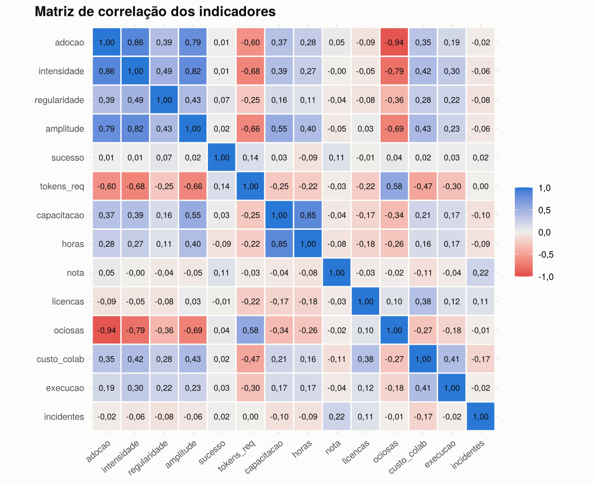
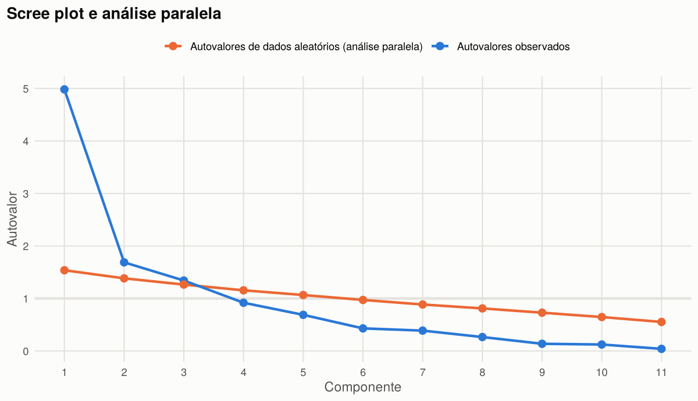
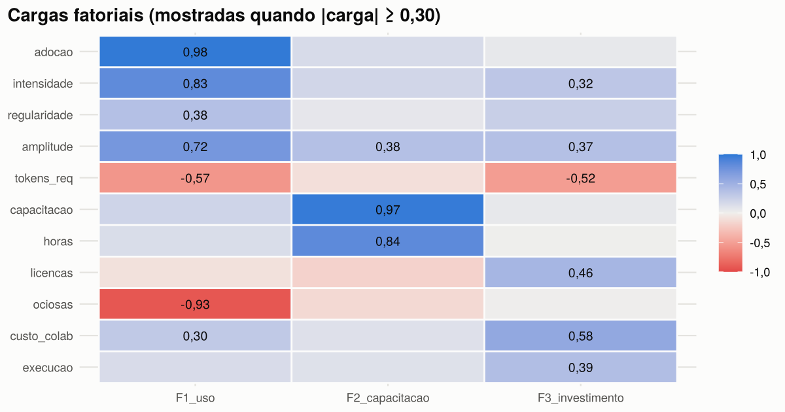
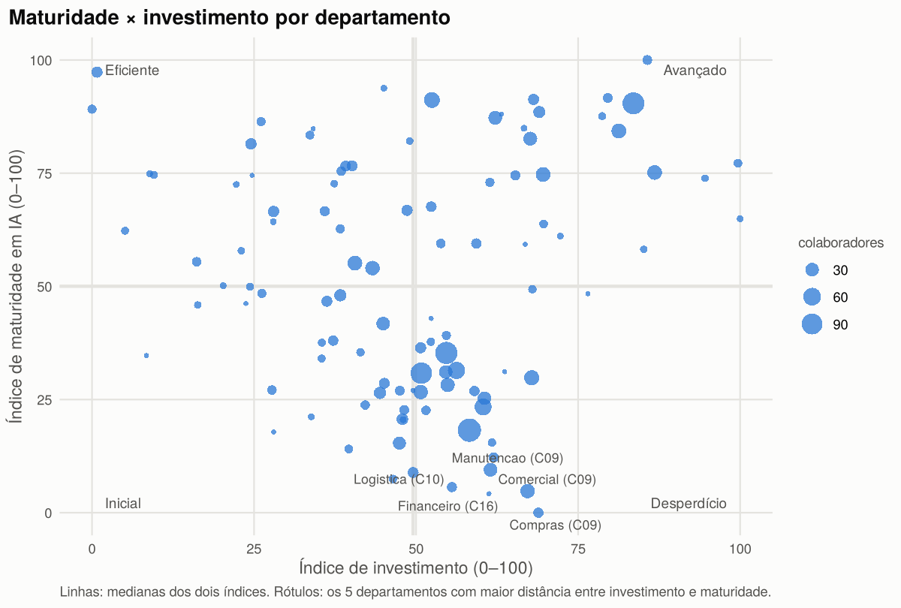
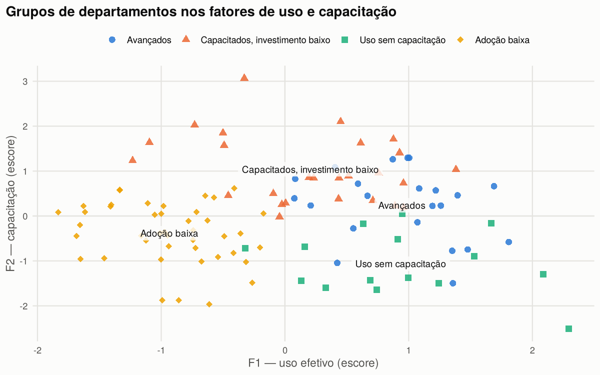

# Estatística Multivariada — Deliverable 2

**Indicadores organizacionais de maturidade no uso de IA.** O trabalho continua o relatório do D1 (`Deliverable1/EstatisticaMulti`), que testou H1 e H2 com correlações simples. A conclusão do D1 pedia "uma análise multivariada mais robusta, controlando por área, cargo e exposição às ferramentas". Este trabalho faz essa análise.

## Arquivos

| Arquivo | Conteúdo |
|---|---|
| `analise_multivariada.Rmd` | Código e texto da análise (R Markdown) |
| `analise_multivariada.html` | Relatório renderizado, com tabelas e gráficos; abre em qualquer navegador |
| `resultados/indicadores_departamentos.csv` | Os 14 indicadores de cada departamento |
| `resultados/cargas_fatoriais.csv` | Cargas da análise fatorial e comunalidades |
| `resultados/indices_departamentos.csv` | Escores fatoriais, IMIA, IINV e grupo de cada departamento |
| `resultados/indices_empresas.csv` | Índices por empresa |
| `resultados/perfil_clusters.csv` | Perfil médio dos quatro grupos |
| `figuras/` | Gráficos usados abaixo |

## Técnicas aplicadas

| Etapa | Técnica | Para quê |
|---|---|---|
| Adequação | Matriz de correlação, distância de Mahalanobis, KMO e MSA, teste de esfericidade de Bartlett | Verificar se há estrutura comum, detectar atípicos e descartar variáveis sem correlação com as demais |
| Redução de dimensão | Análise de componentes principais, critério de Kaiser, scree plot e análise paralela | Decidir quantas dimensões existem |
| Construtos | Análise fatorial exploratória (máxima verossimilhança, varimax), comunalidades, TLI e RMSEA | Identificar e nomear as dimensões |
| Confiabilidade | Alfa de Cronbach padronizado | Verificar se os itens de cada fator medem a mesma coisa |
| Robustez | Rotação oblimin e congruência de Tucker sem os atípicos | Verificar se o resultado depende das escolhas |
| Índices | Escores fatoriais ponderados pela variância explicada | Construir o Índice de Maturidade em IA (IMIA) e o Índice de Investimento (IINV) |
| Agrupamento | Hierárquico (Ward) e k-means, silhueta | Encontrar perfis de departamento |
| Validação | MANOVA (traço de Pillai), ANOVAs, análise discriminante linear com validação cruzada | Verificar se grupos e setores diferem de fato |
| Hipóteses do D1 | Regressão linear múltipla e regressão logística com controles | Retestar H1 e H2 controlando setor, cargo, tempo de casa e exposição |

## Dados

A unidade de análise é o **departamento**, onde a empresa decide licenças, treinamentos e orçamento. O período vai de janeiro a julho de 2026 e só entram colaboradores ativos.

Dos 154 departamentos, 110 têm pelo menos 5 colaboradores ativos. Quatro deles não tiveram nenhum uso de IA no período: ficam fora da análise fatorial e entram no fim do ranking. Restam **106 departamentos**.

Os 14 indicadores candidatos combinam sete bases do projeto (uso, treinamento, licenças, segurança, faturamento, orçamento e cadastro):
- adoção, intensidade, regularidade e amplitude;
- taxa de sucesso e tokens por requisição;
- capacitação, horas de curso e nota;
- licenças por colaborador e licenças ociosas;
- custo por colaborador e execução do orçamento;
- incidentes de segurança.

O dicionário completo está no relatório.

## Resultados



**Adequação.** Três indicadores saíram:
- `nota`: MSA de 0,35 e ausências;
- `sucesso`: MSA de 0,22;
- `incidentes`: MSA de 0,44.

Com os 11 restantes, o **KMO é 0,770** e o **teste de Bartlett é significativo** (χ² = 850,0; gl = 55; p < 0,001). Três departamentos são atípicos pela distância de Mahalanobis. Sem eles, as cargas fatoriais não mudam (congruência de Tucker de 1,000 nos três fatores), então eles continuam na análise.



**Número de dimensões.** Kaiser, scree plot e análise paralela concordam: **3 dimensões**. Os autovalores são 4,98, 1,69 e 1,34, e os três componentes explicam 72,8% da variância.



**Análise fatorial.** Os três fatores explicam 63,1% da variância (TLI = 0,907; RMSEA = 0,111).

| Fator | Variância | Principais cargas | Alfa padronizado |
|---|---:|---|---:|
| **F1 — Uso efetivo** | 33,6% | adoção 0,98; licenças ociosas −0,93; intensidade 0,83; amplitude 0,72; tokens por requisição −0,57 | 0,908 |
| **F2 — Capacitação** | 17,7% | capacitação 0,97; horas de curso 0,84 | 0,917 |
| **F3 — Investimento** | 11,7% | custo por colaborador 0,58; licenças por colaborador 0,46; execução do orçamento 0,39 | 0,563 |

Adoção e licenças ociosas são quase espelhos uma da outra: onde a adoção é baixa, a empresa paga licenças que ninguém usa.

**Índices.** Maturidade e investimento ficam separados: maturidade é o que o departamento faz com a IA, investimento é quanto ele gasta.
- **IMIA:** 65,5% de F1 e 34,5% de F2, de 0 a 100. O resultado praticamente não muda com rotação oblíqua (correlação de 0,995).
- **IINV:** F3, de 0 a 100.

| Setor | Departamentos | IMIA | IINV |
|---|---:|---:|---:|
| Tecnologia / Desenvolvimento de Software | 32 | 81,1 | 71,1 |
| Marketing | 7 | 77,6 | 30,0 |
| Serviços | 11 | 57,4 | 38,9 |
| Varejo | 23 | 38,7 | 43,5 |
| Financeiro | 16 | 35,6 | 50,9 |
| Indústria | 21 | 18,7 | 54,0 |

A Indústria tem a menor maturidade e o segundo maior investimento. O Marketing chega perto da Tecnologia investindo menos da metade. Por empresa:
- **maior maturidade:** Ideia Fresca Marketing (87,4, com investimento de 10,6), NexoCode (84,4) e Vortice (82,7);
- **menor maturidade:** Metalúrgica Vale Forte (17,2), ServPro (19,8) e Química Bandeirantes (20,5).



**27 departamentos estão no quadrante de desperdício**, com investimento acima da mediana e maturidade abaixo dela. São o primeiro alvo da realocação de licenças proposta no [modelo de Pesquisa Operacional](../07_Pesquisa_Operacional_e_Calculo_Aplicado/).



**Agrupamento.** A silhueta empata entre 3 grupos (0,343) e 4 grupos (0,342). A escolha foi por 4, porque o quarto grupo separa um perfil de risco que, com 3 grupos, ficaria misturado a outro:

| Perfil | Departamentos | Colaboradores | Uso (F1) | Capacitação (F2) | Investimento (F3) | Adoção | Licenças ociosas |
|---|---:|---:|---:|---:|---:|---:|---:|
| Avançados | 22 | 422 | 0,94 | 0,24 | 1,11 | 79% | 31% |
| Capacitados, investimento baixo | 26 | 389 | 0,21 | 1,04 | −0,55 | 61% | 44% |
| Uso sem capacitação | 15 | 150 | 0,94 | −1,06 | −0,91 | 71% | 33% |
| Adoção baixa | 43 | 1.057 | −0,93 | −0,38 | 0,08 | 27% | 75% |

**Validação.**
- **MANOVA por grupo:** Pillai = 1,81; F = 51,4; p < 0,001.
- **Análise discriminante:** acerta 84,0% dos departamentos na validação cruzada (leave-one-out), contra 40,6% ao acaso.
- **MANOVA por setor:** Pillai = 1,00; F = 10,1; p < 0,001. O setor pesa muito no uso (F = 22,9) e no investimento (F = 12,2), mas pouco na capacitação (F = 2,31; p = 0,049).

**Hipóteses do D1, com controles** (2.158 colaboradores ativos):

| | Sem controles | Com setor, senioridade, tempo de casa e licenças |
|---|---|---|
| **H1:** efeito de cada curso sobre log(1 + requisições/mês) | 0,499 (p < 0,001; R² = 0,01) | 0,055 (p = 0,51; R² = 0,33) |
| **H2:** razão de chances de incidente por curso | 0,84 (IC 95%: 0,55–1,27) | 0,82 (IC 95%: 0,54–1,25) |

- **H1 era confundida pelo setor.** As empresas de tecnologia treinam mais e também usam mais IA. Controlando o setor, o curso em si não explica o uso.
- **H2 continua não confirmada**, inclusive no nível do departamento (Spearman entre capacitação e incidentes = −0,115; p = 0,24).

## Interpretação para o DAMA

1. **O painel organizacional pode resumir 11 indicadores em três números:** uso efetivo, capacitação e investimento. O IMIA serve de indicador de maturidade por departamento e por empresa.
2. **Licenças ociosas são o sinal mais forte de baixa maturidade** e o mais barato de corrigir, o que liga esta análise ao modelo de otimização.
3. **Risco de segurança precisa de indicador próprio.** Incidentes não acompanham uso, treino nem gasto.
4. **O grupo "uso sem capacitação" é o de maior risco de governança.** Usa IA tanto quanto os avançados, mas com menos da metade da capacitação deles (20% contra 43% dos colaboradores com curso concluído). É o público natural dos níveis de autonomia do DAMA.
5. **Treinamento sozinho não move o uso nem reduz incidentes.** Ele precisa vir junto de acesso às ferramentas certas e metas de uso.

## Limitações

- A base é sintética, e orçamento e gasto foram gerados de forma independente.
- Os incidentes são raros: 64 colaboradores (3,0%), o que limita o poder estatístico dos testes de H2.
- Os indicadores são médias do período; não há análise longitudinal.
- O fator de investimento tem confiabilidade baixa (α = 0,56) e deve ser lido como exploratório.

## Como rodar

No R ou no RStudio:

```r
install.packages(c("rmarkdown", "knitr", "dplyr", "tidyr", "ggplot2", "ggrepel", "psych", "GPArotation", "cluster", "MASS"))
rmarkdown::render("analise_multivariada.Rmd")
```

Os dados são lidos de `Deliverable1/machine-learning-ia/Data/csv/`. A renderização leva cerca de 20 segundos.

Jira: SMAN-195.
