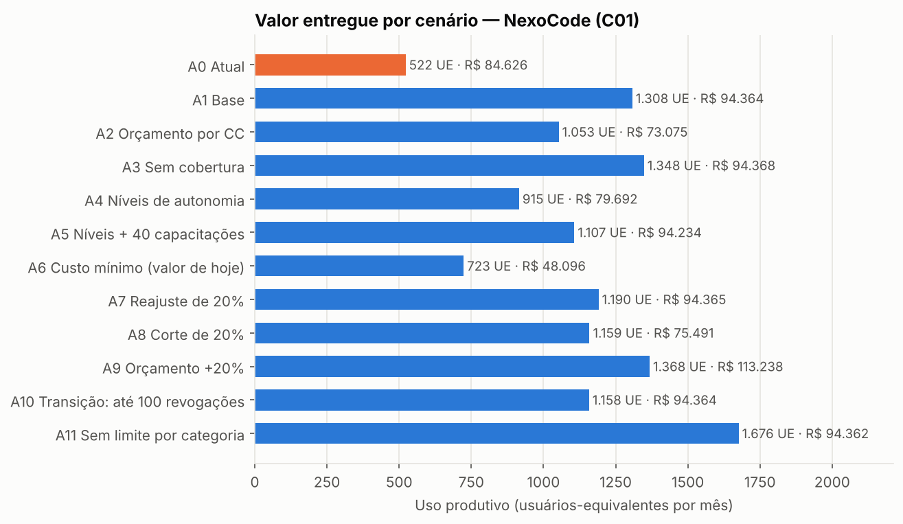
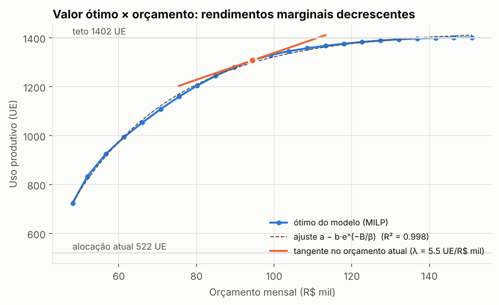
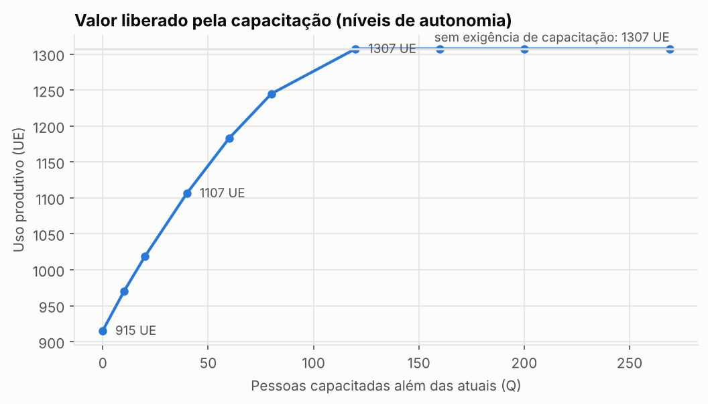
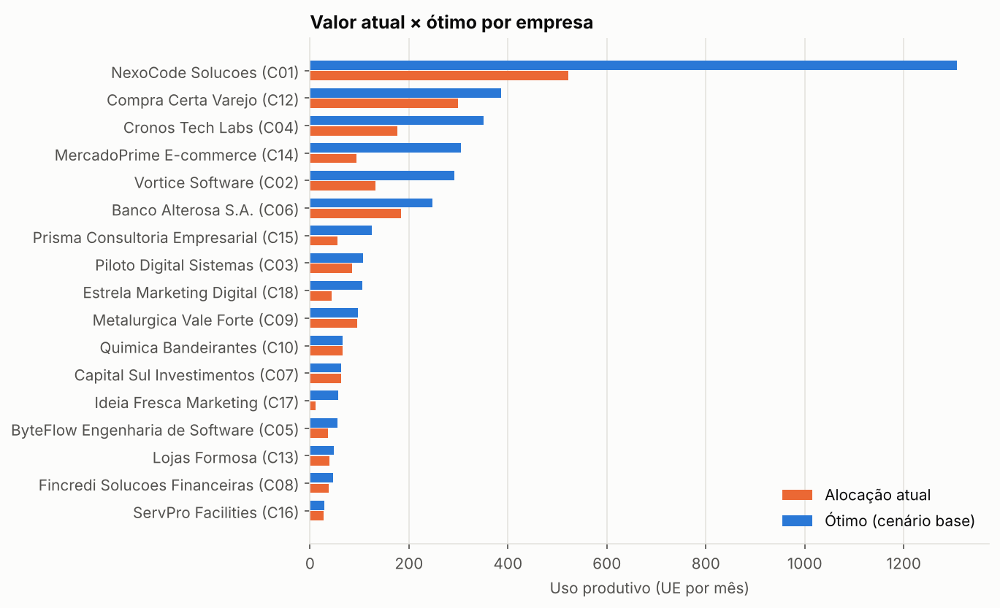

# Pesquisa Operacional e Cálculo Aplicado — Deliverable 2

**Alocação ótima de licenças de IA**: quem deve receber qual ferramenta, dentro do orçamento e das regras de governança. O trabalho continua o modelo do Deliverable 1 (`Deliverable1/PesquisaOperacional`), agora com os dados da base do projeto.

## Resumo dos resultados

Empresa de referência: NexoCode Soluções (C01), com 336 colaboradores ativos, 11 centros de custo e 5 ferramentas por assento aprovadas.

- **Mesmo orçamento, 2,5 vezes o uso produtivo.** A alocação atual custa R$ 84.626 por mês e entrega 522 usuários-equivalentes (UE). A alocação ótima usa o orçamento disponível (R$ 94.364) e entrega 1.307,5 UE, um ganho de 150%. O rendimento por real dobra, de 6,2 para 13,9 UE por R$ 1.000.
- **O problema é de distribuição, não de dinheiro.**
  - 21% das licenças ativas não tiveram nenhum uso em 2026.
  - 42 pessoas pagam duas ferramentas da mesma categoria.
  - 56 colaboradores não têm nenhuma licença.
  - Engenharia de Software gasta 3,5 vezes o próprio orçamento, enquanto RH usa 17% e Jurídico 2%.
- **O orçamento rígido por centro de custo custa 22% do valor.** Com essa regra, o modelo fica inviável se todos precisarem de acesso: Engenharia, Vendas e Marketing não conseguem pagar uma licença por pessoa. Sem a cobertura, ele entrega 1.052,6 UE, contra 1.347,9 UE com orçamento corporativo nas mesmas condições, e deixa R$ 21 mil sem uso em outros centros de custo.
- **Garantir acesso básico a todos é barato.** A cobertura universal custa 3% do valor máximo (1.347,9 UE sem ela, contra 1.307,5 UE com ela).
- **O gargalo do D1 se confirma com dados.** No D1, o limite era o número de capacitados (preço-sombra de 50). No D2, exigir capacitação para licenças além da básica reduz o valor em 30%. Cada uma das primeiras 40 pessoas capacitadas libera de 4,4 a 5,4 UE.
- **Cálculo aplicado.** No orçamento atual, cada R$ 1.000 a mais rende 5,5 UE: o preço-sombra é 5,49, a derivada numérica 5,36 e a do ajuste exponencial 4,72. A elasticidade é 0,40: 1% a mais de orçamento rende 0,40% a mais de valor. Chegar a 95% do teto exigiria R$ 102,5 mil, 9% acima do atual.
- **Nas 17 empresas com ferramentas por assento aprovadas, o uso produtivo sobe 88%** (de 1.967 para 3.690 UE). Outra opção é manter o uso de hoje por R$ 252,7 mil em vez de R$ 386,2 mil, 35% de economia.

## Arquivos

| Arquivo | Conteúdo |
|---|---|
| `modelo_otimizacao_licencas.ipynb` | Notebook executado: dados, modelo, validação, cenários, sensibilidade, capacitação e as 18 empresas |
| `resultados/cenarios_C01.csv` | Os 12 cenários da NexoCode |
| `resultados/plano_licencas_C01.csv` | Uma linha por licença, com a ação (manter, revogar ou atribuir), ferramenta e departamento |
| `resultados/transicao_C01.csv` | Valor obtido com limite de revogações por mês |
| `resultados/curva_orcamento_C01.csv` | Valor ótimo, preço-sombra e derivada para orçamentos de 50% a 160% |
| `resultados/curva_capacitacao_C01.csv` e `capacitacao_prioritaria_C01.csv` | Valor por número de capacitações e as 40 pessoas a capacitar primeiro |
| `resultados/empresas.csv` | Modelo aplicado às 18 empresas |
| `resultados/fig1` a `fig5` | Gráficos usados abaixo |

## 1. Do D1 ao D2

O modelo do D1 tinha duas variáveis (licenças de Copiloto e de Assistente), coeficientes supostos e duas restrições (orçamento de R$ 1.000 e 40 capacitados). O notebook resolve esse modelo como ponto de partida. O ótimo é $x_1 = 40$, $x_2 = 0$, $Z = 2.000$. Sobram R$ 200 de orçamento, e o preço-sombra dos capacitados é 50, ou seja, o limite era a capacitação e não o dinheiro.

O D2 mantém a pergunta e muda a escala:

| | Deliverable 1 | Deliverable 2 |
|---|---|---|
| Coeficientes | Supostos | Extraídos de `ai_billing`, `ai_budgets`, `ai_usage_logs`, `training_records`, `approved_ai_tools` |
| Decisão | Quantas licenças de cada tipo | Quem recebe cada licença (1.554 variáveis binárias) |
| Restrições | Orçamento e capacitados | Orçamento, governança, categoria, cobertura, níveis de autonomia, capacidade de treino, transição |
| Solução | Simplex à mão | PuLP + CBC, programação linear inteira, poucos segundos por cenário |
| Análise | — | 12 cenários, curva de orçamento, preço-sombra, elasticidade, 18 empresas |

## 2. Dados e premissas

| Parâmetro | Fonte | Cálculo |
|---|---|---|
| $c_t$ custo mensal da licença | `ai_billing.csv` | custo em R$ ÷ licenças faturadas, jan–jul/2026 |
| $B_d$ orçamento do centro de custo | `ai_budgets.csv` | média mensal de 2026, menos o consumo pago em US$ |
| $v_{e,t}$ valor da licença | `ai_usage_logs.csv` | requisições bem-sucedidas por mês ÷ mediana dos usuários da ferramenta (em UE) |
| $a_{d,t}$ governança | `approved_ai_tools.csv` | aprovada e com o departamento na lista de autorizados |
| $k_e$ capacitação | `training_records.csv` | concluiu curso de Segurança e Compliance ou Governança |

Premissas:

- **Usuário-equivalente (UE).** 1 UE é o uso mensal do usuário mediano daquela ferramenta. A normalização permite comparar um copiloto de código, com centenas de requisições por mês, com um assistente de texto, com algumas dezenas.
- **Substituição.** Duas ferramentas da mesma categoria são substitutas: para a mesma pessoa, conta só a de maior uso. A alocação atual também é avaliada assim (valor efetivo de 522,2 UE, contra 572,7 UE se as duplicadas fossem somadas). O cenário A11 mostra o efeito de retirar essa premissa.
- **Câmbio.** R$ 5,50 por US$. O efeito é pequeno, porque o consumo pago em dólar é menos de 2% do orçamento.
- **Período.** Janeiro a julho de 2026, os sete meses mais recentes da base.

## 3. Modelo

**Variáveis.**
- $y_{e,t}\in\{0,1\}$: o colaborador $e$ recebe a ferramenta $t$.
- $z_e \in\{0,1\}$: o colaborador $e$ é capacitado (só no cenário de capacitação).

**Objetivo.** $\max V = \sum_{(e,t)} v_{e,t}\,y_{e,t}$

**Restrições.**

| # | Restrição |
|---|---|
| R1 | Orçamento corporativo: $\sum c_t\,y_{e,t} \le \sum_d B_d$. Na variante R1', cada centro de custo fica limitado ao próprio $B_d$ |
| R2 | No máximo uma ferramenta por categoria por pessoa |
| R3 | Só ferramentas aprovadas para o departamento da pessoa |
| R4 | Cobertura: todo colaborador ativo recebe pelo menos uma licença (acesso básico) |
| R5 | Níveis de autonomia: sem capacitação, só a licença básica, $\sum_t y_{e,t} \le 1 + (n_e-1)\,z_e$ |
| R6 | Capacidade de capacitação: $\sum_e z_e \le Q$ |
| R7 | Transição: no máximo $R$ licenças atuais revogadas, $\sum_{(e,t)\in\text{atuais}} (1-y_{e,t}) \le R$ |

R4 e R5 trazem para o modelo a lógica do DAMA: todos têm um nível básico de acesso à IA, e o acesso a mais ferramentas depende de letramento comprovado.

**Formulação dual (cenário A6).** Minimizar o custo $\sum c_t\,y_{e,t}$ sujeito a $V \ge V_{\text{atual}}$.

## 4. Validação

| Verificação | Resultado |
|---|---|
| Solver reproduz o D1 | $x_1=40$, $x_2=0$, $Z=2.000$, preço-sombra dos capacitados = 50 |
| Restrições conferidas fora do solver (orçamento, categoria, governança, cobertura) | Todas atendidas |
| Distância entre a solução inteira e a relaxação linear | 0,0022%, ou seja, a solução está no ótimo |
| Comparação com heurística gulosa (maior valor por real primeiro) | Ótimo 1.307,5 UE contra 1.272,0 UE da heurística (+2,8%) |
| Ajuste da curva de orçamento | $R^2 = 0{,}9985$ |

## 5. Cenários (NexoCode, C01)



| Cenário | Licenças | Custo/mês | Valor (UE) | UE por R$ mil | vs. atual |
|---|---:|---:|---:|---:|---:|
| A0 Atual | 468 | R$ 84.626 | 522,2 | 6,17 | — |
| A1 Base | 576 | R$ 94.364 | 1.307,5 | 13,86 | +150% |
| A2 Orçamento rígido por centro de custo¹ | 429 | R$ 73.075 | 1.052,6 | 14,41 | +102% |
| A3 Sem cobertura | 554 | R$ 94.368 | 1.347,9 | 14,28 | +158% |
| A4 Níveis de autonomia (67 capacitados) | 443 | R$ 79.692 | 915,3 | 11,49 | +75% |
| A5 Níveis + 40 capacitações | 524 | R$ 94.234 | 1.106,7 | 11,74 | +112% |
| A6 Custo mínimo para o valor de hoje | 336 | R$ 48.096 | 723,4 | 15,04 | +39% |
| A7 Reajuste de 20% nos preços | 496 | R$ 94.365 | 1.190,5 | 12,62 | +128% |
| A8 Corte de 20% no orçamento | 480 | R$ 75.491 | 1.159,4 | 15,36 | +122% |
| A9 Orçamento +20% | 668 | R$ 113.238 | 1.367,5 | 12,08 | +162% |
| A10 Transição: até 100 revogações | 557 | R$ 94.364 | 1.157,7 | 12,27 | +122% |
| A11 Sem limite por categoria | 576 | R$ 94.362 | 1.675,8 | 17,76 | +221% |

¹ Inviável com cobertura para todos: o orçado de Engenharia de Software, Vendas e Marketing não paga uma licença por pessoa. O resultado mostrado é sem R4 e deve ser comparado com A3 (também sem R4): 1.052,6 contra 1.347,9 UE, 22% a menos.

**Como ler.**
- O corte de 20% no orçamento (A8) tira só 11% do valor, enquanto 20% a mais (A9) acrescenta só 4,6%. A diferença entre os dois mostra o rendimento decrescente.
- Uma licença bem escolhida por pessoa (A6) já entrega 39% mais uso que hoje, com 43% menos custo.
- A premissa de substituição pesa no resultado: sem ela (A11), o valor sobe mais 28%. Antes de qualquer decisão, essa premissa precisa ser validada com os usuários.

## 6. Plano de ação de licenças

Comparada com as licenças ativas, a solução do cenário base gera o seguinte plano:

| Ação | Licenças | Custo/mês | Valor (UE) |
|---|---:|---:|---:|
| Manter | 161 | R$ 26.799 | 350,6 |
| Revogar | 307 | R$ 57.827 | 222,1 |
| Atribuir | 415 | R$ 67.565 | 956,8 |

As licenças revogadas rendem 3,8 UE por R$ 1.000; as atribuídas, 14,2. Na prática, a troca seria feita aos poucos. Com um limite de revogações por mês (R7), o valor obtido fica assim:

| Revogações permitidas | 42 (mínimo, só as duplicadas) | 50 | 100 | 150 | 200 | 300 |
|---|---:|---:|---:|---:|---:|---:|
| Valor (UE) | 980,9 | 1.015,9 | 1.157,7 | 1.235,6 | 1.275,9 | 1.307,1 |
| Parcela do ganho do cenário base | 58% | 63% | 81% | 91% | 96% | 100% |

Só eliminando as duplicadas e usando o orçamento que sobra, já se obtém 58% do ganho. Com 100 revogações no primeiro mês, chega-se a 81%. O arquivo `plano_licencas_C01.csv` lista cada licença com a ação correspondente.

## 7. Cálculo aplicado: valor marginal do orçamento



O modelo foi resolvido para orçamentos de 51% (o mínimo viável, só a cobertura) a 160% do atual. A curva $V(B)$ é côncava, o que caracteriza rendimentos marginais decrescentes. Ela foi ajustada por

$$V(B) = a - b\,e^{-B/\beta},\qquad a = 1.427{,}7,\; b = 4.014{,}8,\; \beta = 27.490 \quad (R^2 = 0{,}9985)$$

cuja derivada é

$$V'(B) = \frac{b}{\beta}\,e^{-B/\beta} > 0, \qquad V''(B) = -\frac{b}{\beta^2}\,e^{-B/\beta} < 0$$

No orçamento atual ($B_0$ = R$ 94.369), o valor marginal foi medido de três formas:

| Método | UE por R$ 1.000 |
|---|---:|
| Preço-sombra da restrição R1 (dual da relaxação linear) | 5,49 |
| Derivada numérica (diferenças centrais) | 5,36 |
| Derivada do ajuste $V'(B_0)$ | 4,72 |

Os três métodos concordam. A elasticidade é $\varepsilon = \lambda\,B_0/V_0 = 0{,}40$. O teto, com orçamento ilimitado, é de 1.401,5 UE. Para chegar a 95% dele, basta resolver $V(B) = 0{,}95\,V_\infty$, o que dá $B = -\beta\ln\big((a-0{,}95V_\infty)/b\big)$ = R$ 102,5 mil, 9% acima do orçamento atual. Daí em diante, cada real rende pouco.

Lido junto com a seção 6, o resultado sugere que, antes de pedir mais orçamento, vale realocar o que já existe: a realocação multiplica o valor por 2,5, enquanto 20% a mais de orçamento acrescenta 4,6%.

## 8. Capacitação como investimento



| Pessoas capacitadas além das atuais | 0 | 10 | 20 | 40 | 60 | 80 | 120 |
|---|---:|---:|---:|---:|---:|---:|---:|
| Valor (UE) | 915,3 | 969,7 | 1.018,5 | 1.106,7 | 1.183,1 | 1.244,9 | 1.307,5 |
| Ganho por pessoa no intervalo | — | 5,44 | 4,88 | 4,41 | 3,82 | 3,09 | 1,57 |

O modelo também escolhe quem capacitar. Das 40 primeiras pessoas, 12 são de Engenharia de Software, 7 de Suporte ao Cliente, 7 de Vendas, 5 de QA, 5 de DevOps, 2 do Financeiro e 2 de Produto. A lista completa está em `capacitacao_prioritaria_C01.csv`.

A partir de 120 pessoas capacitadas, a exigência deixa de limitar: o valor é o mesmo do cenário sem exigência. Esse é o número a usar no planejamento do programa de letramento, que no DAMA vem antes de liberar mais autonomia.

## 9. Aplicação às 18 empresas



O mesmo modelo, sem nenhum ajuste, foi aplicado a todas as empresas da base. A TextilNorte (C11) fica de fora por não ter ferramenta por assento aprovada. Nas outras 17:

- o valor total vai de 1.967 para 3.690 UE (+88%);
- alternativamente, o uso de hoje pode ser mantido por R$ 252,7 mil por mês em vez de R$ 386,2 mil (−35%);
- há 1.513 licenças ativas ociosas e 642 licenças ativas de ferramentas fora da política de aprovação;
- em 7 empresas, o orçamento por centro de custo não cobre uma licença por pessoa.

O ganho depende do perfil de cada empresa. Onde as ferramentas aprovadas são todas da mesma categoria e sobra orçamento (Capital Sul, Metalúrgica Vale Forte, Química Bandeirantes), o valor quase não muda, mas o custo cai de 49% a 68%. Onde quase ninguém tem licença (Ideia Fresca, MercadoPrime), a cobertura universal custa mais do que se gasta hoje e o valor sobe bastante.

## 10. Recomendações

1. **Revogar primeiro as licenças sem uso e as duplicadas.** É a ação de menor risco e já entrega mais da metade do ganho.
2. **Gerir o orçamento de IA no nível corporativo**, com limites por centro de custo apenas como referência. Com a regra rígida, perde-se 22% do valor, e o orçado de três áreas não cobre o acesso básico.
3. **Capacitar 40 pessoas no próximo ciclo**, começando pela lista gerada pelo modelo, e chegar a 120 para eliminar o gargalo.
4. **Revisar a premissa de substituição** (uma ferramenta por categoria) com os usuários antes de cortar segundas ferramentas, porque o valor é sensível a ela (A11).
5. **Não pedir aumento de orçamento antes de realocar.** No ponto atual, cada 1% de orçamento a mais rende 0,40% de valor.

## 11. Limitações

- O valor mede uso (requisições bem-sucedidas), não resultado de negócio.
- Quem nunca usou uma ferramenta recebe $v = 0$, então o modelo não aposta em adoção nova.
- A base é sintética. O orçamento e o gasto foram gerados de forma independente, e isso exagera o descompasso entre centros de custo.
- O modelo é estático, de um mês. A expiração de contratos e o custo de mudar de ferramenta não entram, exceto pelo limite de revogações (R7).

## Como rodar

```bash
pip install pandas matplotlib scipy pulp==2.9.0
jupyter notebook modelo_otimizacao_licencas.ipynb
```

Os dados são lidos de `Deliverable1/machine-learning-ia/Data/csv/`. O PuLP 2.9 traz o solver CBC embutido; a versão 4 mudou a API e não roda este notebook sem ajustes. Para analisar outra empresa, basta trocar `EMPRESA` na primeira célula.

Jira: SMAN-199.
