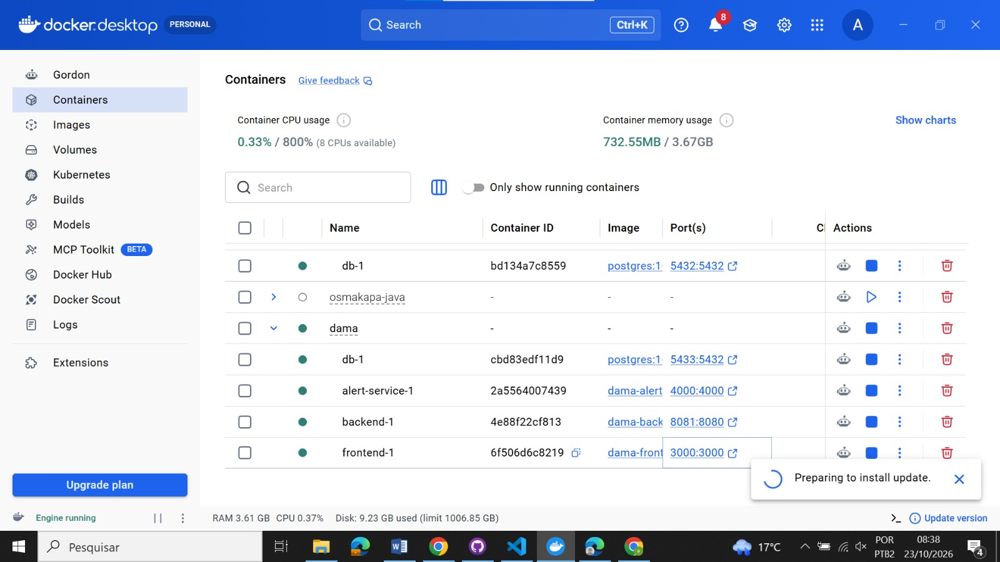

# Evidência — Execução do ambiente com Docker

O Docker Desktop apresenta os containers do projeto DAMA em execução, incluindo frontend, backend, banco de dados PostgreSQL e alert-service. A captura demonstra que os principais serviços foram inicializados e que suas respectivas portas estão configuradas para acesso. Essa evidência registra a execução do ambiente de desenvolvimento do MVP, mas não substitui os testes funcionais da aplicação.

